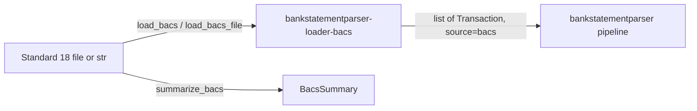

<!-- SPDX-License-Identifier: Apache-2.0 OR MIT -->

<p align="center">
  
</p>

<h1 align="center">bankstatementparser-loader-bacs</h1>

<p align="center">
  UK BACS Standard 18 loader that parses fixed-width Direct Debit and Direct Credit files into bankstatementparser Transaction objects.
</p>

<p align="center">
  <a href="https://github.com/sebastienrousseau/bankstatementparser-loader-bacs/actions"></a>
  <a href="https://pypi.org/project/bankstatementparser-loader-bacs/"></a>
  <a href="https://sebastienrousseau.com/bankstatementparser-loader-bacs/"></a>
  <a href="https://scorecard.dev/viewer/?uri=github.com/sebastienrousseau/bankstatementparser-loader-bacs"></a>
  <a href="LICENSE"></a>
  <a href="https://github.com/sebastienrousseau/bankstatementparser-loader-bacs/blob/main/docs/POLICIES.md"></a>
</p>

<p align="center">
  
</p>

---

## Contents

**Getting started**

- [Install](#install): PyPI, source
- [Requirements](#requirements): toolchain floor, platforms
- [Quick Start](#quick-start): parse a file in three lines

**The bankstatementparser-loader-bacs ecosystem**

- [The bankstatementparser-loader-bacs ecosystem](#the-bankstatementparser-loader-bacs-ecosystem): the core library, the other loaders and writers

**Library reference**

- [Capabilities at a glance](#capabilities-at-a-glance): the current surface by theme
- [Ecosystem comparison](#ecosystem-comparison): short matrix; full table at [`docs/COMPARISON.md`](docs/COMPARISON.md)
- [Benchmarks](#benchmarks): headline numbers; full table at [`docs/BENCHMARKS.md`](docs/BENCHMARKS.md)
- [Features](#features): public API, record layout, amounts and signs
- [Configuration](#configuration): core options
- [Examples](#examples): runnable example index

**Operational**

- [When not to use bankstatementparser-loader-bacs](#when-not-to-use-bankstatementparser-loader-bacs): limitations
- [Development](#development): make targets, fuzzing, CI
- [Security](#security): guarantees and compliance
- [Documentation](#documentation): all reference docs
- [Stability guarantees](#stability-guarantees): SemVer axis, output stability, minimum toolchain discipline
- [License](#license)

---

## Install

### As a Python library

```bash
pip install bankstatementparser-loader-bacs
```

That installs the loader and `bankstatementparser >= 0.0.36`, which brings `pandas` and `pydantic`.

| Channel | Command | Notes |
| :--- | :--- | :--- |
| PyPI | `pip install bankstatementparser-loader-bacs` | Pulls in `bankstatementparser >= 0.0.36` |
| Source | `git clone https://github.com/sebastienrousseau/bankstatementparser-loader-bacs && cd bankstatementparser-loader-bacs && poetry install` | For development |

Verify the installation:

```sh
python -c "import bankstatementparser_loader_bacs as b; print(b.__version__)"
# -> 0.0.37
```

An isolated virtual environment keeps the loader's dependencies apart:

```sh
python -m venv venv
source venv/bin/activate        # macOS/Linux
venv\Scripts\activate           # Windows
python -m pip install -U bankstatementparser-loader-bacs
```

---

## Requirements

- **Python 3.10 or later.** CI tests CPython 3.10, 3.11, 3.12, 3.13 and 3.14 on Linux, macOS and Windows; [`docs/POLICIES.md`](docs/POLICIES.md) says when the floor moves.
- **[`bankstatementparser`](https://pypi.org/project/bankstatementparser/) 0.0.36 or later**, whose `Transaction` model and `BankStatementParser` base class the loader produces and extends.
- No network access, native extensions or system packages of its own.

---

## Quick Start

```python
from bankstatementparser_loader_bacs import load_bacs_file

for txn in load_bacs_file("submission.bacs"):
    print(txn.booking_date, txn.amount, txn.account_id, txn.description)
```

Or parse an in-memory payload:

```python
from bankstatementparser_loader_bacs import load_bacs

payload = "\n".join(
    [
        "UHL1 26015123456    000000001 DAILY  000",
        "2000001234567809940000087654321000000000250000"
        "ACME CORP LTD     JANUARY SALARY    JOHN DOE           26015",
        "2000008877665501740000087654321000000000004550"
        "ACME CORP LTD     ELECTRICITY BILL  JANE SMITH        160126",
    ]
)

for txn in load_bacs(payload):
    print(txn.booking_date, txn.amount, txn.category, txn.description)
# 2026-01-15 2500 bacs:99 ACME CORP LTD - JANUARY SALARY
# 2026-01-16 -45.5 bacs:17 JANE SMITH - ELECTRICITY BILL
```

Both return a flat `list` of `bankstatementparser.transaction_models.Transaction` objects with `source="bacs"`, ready for the rest of a `bankstatementparser` pipeline.

---

## The bankstatementparser-loader-bacs ecosystem

bankstatementparser-loader-bacs is one of the input loaders of the `bankstatementparser` suite, whose packages ship one version together. The full table is in [The suite](docs/suite.md).

| Component | Purpose | Use case |
| :--- | :--- | :--- |
| [`bankstatementparser`](https://github.com/sebastienrousseau/bankstatementparser) | The parser core: CAMT, pain.001, CSV, OFX, QFX, MT940, MT942, BAI2 and PDF statements, and the `Transaction` model | Parsing statements from Python or the CLI |
| **`bankstatementparser-loader-bacs`** | This loader: Standard 18 text to `Transaction` objects, with the transaction code kept and debits signed negative | Loading UK Bacs submission files |
| Other loaders | BAI2, MT942, CFONB 120, CAMT.054 and SEPA pain.002 / pain.008 | Formats beyond the core |
| Writers and transport | XLSX, QIF, OFX and SWIFT writers; EBICS retrieval | Exporting transactions and fetching statements |
| [`bankstatementparser-mcp`](https://github.com/sebastienrousseau/bankstatementparser-mcp), [`bankstatementparser-lsp`](https://github.com/sebastienrousseau/bankstatementparser-lsp) | Agent tools and editor diagnostics over the core | AI agents and MT940 editing |



---

## Capabilities at a glance

| Area | Capability | Status |
| :--- | :--- | :--- |
| Loading | `load_bacs` (text or lines) and `load_bacs_file` (path) to `list[Transaction]` | Shipped |
| Summary | `summarize_bacs` to a `BacsSummary` (service user number, originator, date, count, credit and debit totals) without building transactions | Shipped |
| Core integration | `BacsStatementParser`, a `BankStatementParser` registered as `bacs` and `std18` in `bankstatementparser.loaders` | Shipped |
| Records | `UHL1` and 100- or 106-character detail records; `VOL1`, `HDR1`, `HDR2`, `EOF1`, `EOF2`, `UTL1` skipped | Shipped |
| Robustness | CRLF, blank and short lines, unparsable dates and stray characters in amounts never raise | Shipped |
| Control totals | Validating the `UTL1` trailer counts and sums | Not in this loader |
| Writing | Producing Standard 18 files | Not in this loader |

---

## Ecosystem comparison

The core `bankstatementparser` reads no Standard 18, and no other maintained Python package on PyPI that does was found (the PyPI names `bacs`, `pybacs`, `bacs-parser` and `python-bacs`, checked on 2026-11-27; `bacs` is an unrelated camera library).

| Project | Reads Standard 18 | `Transaction` output | Signs Direct Debits |
| :--- | :---: | :---: | :---: |
| **bankstatementparser-loader-bacs** | Yes | Yes | Yes (`01`, `17`, `18`, `19`) |
| `bankstatementparser` 0.0.35 | No | Yes | Not applicable |
| Slicing the columns by hand | Yes | No | Your code |

See [`docs/COMPARISON.md`](docs/COMPARISON.md) for the evidence and complete matrix.

---

## Benchmarks

`benches/bench_load_bacs.py` times `load_bacs` and `summarize_bacs` on Standard 18 files of 10 to 50,000 detail records. Cost per record rises only 1.16x from 10 to 50,000 records, and a summary costs at most 0.73x a full load.

| Scenario | Result | Environment |
| :--- | ---: | :--- |
| `load_bacs`, 1,000 records (105 KiB) | 4.92 ms | Apple M1 Pro, macOS 27.2.1, CPython 3.12.16 |
| `load_bacs`, 50,000 records (5.1 MiB) | 308.66 ms | Apple M1 Pro, macOS 27.2.1, CPython 3.12.16 |
| `summarize_bacs`, 50,000 records (5.1 MiB) | 178.56 ms | Apple M1 Pro, macOS 27.2.1, CPython 3.12.16 |

See [`docs/BENCHMARKS.md`](docs/BENCHMARKS.md) for methodology and full results.

---

## Features

<!-- --8<-- [start:features] -->

### Public API

```python
from bankstatementparser_loader_bacs import (
    BacsStatementParser,
    BacsSummary,
    load_bacs,
    load_bacs_file,
    summarize_bacs,
)
```

| Class / Function | Signature | Returns |
| :--- | :--- | :--- |
| `load_bacs` | `load_bacs(text_or_lines)`: a `str` or an iterable of lines | `list[Transaction]` |
| `load_bacs_file` | `load_bacs_file(path)`: a `str` or `os.PathLike` | `list[Transaction]` |
| `summarize_bacs` | `summarize_bacs(text_or_lines)`: a `str` or an iterable of lines | `BacsSummary` |
| `BacsStatementParser` | `BacsStatementParser(file_name)` | `BankStatementParser` with `parse()` (DataFrame), `to_transactions()` and `get_summary()` (dict) |

`BacsSummary` is a frozen dataclass with the fields `service_user_number`, `originating_sort_code`, `originating_account`, `currency` (always `GBP`), `submission_date`, `transaction_count`, `total_credit` and `total_debit` (both positive `Decimal`s).

### Record layout

A detail record is a line of at least 30 characters whose first six are digits. The loader reads these columns (1-based, inclusive); `tests/test_docs_accuracy.py` checks every row of this table against the parser:

| Columns | Field Name | Description |
| :--- | :--- | :--- |
| `1-6` | Destination Sort Code | Beneficiary bank sort code |
| `7-14` | Destination Account | Beneficiary account number |
| `15` | Destination Account Type | Account type digit (not read) |
| `16-17` | Transaction Code | 2-character BACS code (`99`, `01`, `17`, ...); `99` when the line ends before it |
| `18-23` | Originating Sort Code | Service user's (sender's) sort code |
| `24-31` | Originating Account | Service user's account number |
| `32-35` | Free Format | Not read |
| `36-46` | Amount | 11-digit amount in pence |
| `47-64` | Originator Name | Service user's name |
| `65-82` | Reference | Payment reference |
| `83-100` | Destination Name | Beneficiary account name |
| `101-106` | Processing Date | Optional: `YYDDD` (Julian), `DDMMYY` or `YYMMDD`; else the UHL1 date |

The `UHL1` header gives the file's processing date (columns 5-10) and service user number (11-16). The other labels are skipped.

### Mapping to `Transaction`

| `Transaction` field | Source |
| :--- | :--- |
| `account_id` | `<destination sort code>-<destination account>`, else the originating account, else `BACS` |
| `currency` | Always `GBP` |
| `amount` | Pence / 100 as a `Decimal`, signed by the convention below |
| `booking_date`, `value_date` | The processing date, else the `UHL1` date |
| `description` | Debit: the destination name; credit: the originator name (or the destination name, or `BACS Transfer`); then a hyphen and the reference, unless the text already contains it |
| `reference` | The reference field, or `None` when blank |
| `category` | `bacs:<transaction code>`, or `None` when the code is blank |
| `source`, `source_index` | `"bacs"` and the record's position in the file |

### Amount and sign convention

The amount field holds pence. The loader keeps its ASCII digits (spaces and any other character are dropped; an empty field is `0`) and divides by 100 as a `decimal.Decimal`, never a `float`.

| Transaction code | Meaning | Sign |
| :--- | :--- | :--- |
| `01`, `17`, `18`, `19` | Direct Debit: first, regular, re-presented, final | **negative** |
| anything else (`99`, `Z4`, blank, ...) | Credit | **positive** |

### Errors

None of the functions raises on malformed Standard 18 text: a line that is not a record is skipped, a date that does not parse falls back to the `UHL1` date, and an amount keeps its ASCII digits. `load_bacs_file` raises `OSError` when the file cannot be read; undecodable bytes are replaced, not refused.

<!-- --8<-- [end:features] -->

---

## Configuration

The loader has no options, configuration file or environment variables: the record layout and the sign convention above are fixed, so the same file always loads the same way. Installing the package registers `BacsStatementParser` under the `bacs` and `std18` names in the `bankstatementparser.loaders` entry-point group, which is how the core discovers it; nothing needs to be configured for that.

---

## Examples

[`examples/`](examples/) holds two runnable scripts, each run in CI against an inline sample, so no data files are needed:

| Example | Demonstrates |
| :--- | :--- |
| [`01_basic_usage.py`](examples/01_basic_usage.py) | `load_bacs` and `summarize_bacs` on a file with a credit and two Direct Debits |
| [`02_advanced_workflow.py`](examples/02_advanced_workflow.py) | `BacsStatementParser` reading a file from disk as a DataFrame and a summary, reconciled with `load_bacs_file` |

```sh
python examples/01_basic_usage.py
```

---

## When not to use bankstatementparser-loader-bacs

- **You need to write Standard 18.** This loader only reads; it builds no submission file.
- **You need the trailer totals checked.** `UTL1` counts and sums are skipped, not reconciled; compare them with `summarize_bacs` yourself.
- **You need Bacs reports (ARUDD, AUDDIS, ADDACS).** Those have their own formats; this loader reads the Standard 18 submission layout only.
- **You want malformed input refused.** The loader is lenient by design: it skips what it cannot read rather than raising.

---

## Development

```bash
git clone https://github.com/sebastienrousseau/bankstatementparser-loader-bacs.git
cd bankstatementparser-loader-bacs
poetry install
make check
```

`make check` runs the local gates: `ruff` lint and format, `mypy --strict`, the complexity baseline (`scripts/check_complexity.py`), `bandit`, `pytest` with a 100% line + branch coverage floor, `interrogate` at 100% docstring coverage, and the examples. Other targets: `make fuzz` (Atheris, 60 s, Linux x86_64 with Python 3.12+), `make bench`, `make audit` (`pip-audit` on every locked set), `make docs` (the MkDocs manual, `--strict`) and `make demo` (re-renders the GIF above with VHS from `.github/demo.tape`). CI adds the OS by Python matrix, the fuzz run, CodeQL, `pip-audit` and the Docs Lint gates. [`CONTRIBUTING.md`](CONTRIBUTING.md) covers branches and commit signing.

---

## Security

- **Read-only.** The loader only reads text and files you pass it; it writes nothing.
- **No XML, no network, no code execution.** Parsing is fixed-column string slicing into dataclasses.
- **Decimal arithmetic** for every amount, and only ASCII digits count as digits, so a stray character cannot become part of a number.
- **Fuzzing.** `fuzz/fuzz_load_bacs.py` drives `load_bacs` and `summarize_bacs` with Atheris in CI, seeded with the repository's fixtures, and fails on any exception, any malformed `Transaction` and any disagreement between the load and the summary.
- **Supply chain.** Dependencies are locked in `poetry.lock`, CI installs hash-pinned exports of it, and `pip-audit` and CodeQL run on every change. Releases publish to PyPI through OIDC trusted publishing and carry cosign signatures, SLSA provenance and SBOMs; every workflow action is pinned by commit SHA except the SLSA generator, which must be referenced by tag.

Report vulnerabilities according to [`SECURITY.md`](SECURITY.md).

---

## Documentation

- **User manual:** [sebastienrousseau.com/bankstatementparser-loader-bacs](https://sebastienrousseau.com/bankstatementparser-loader-bacs/), built from [`docs/`](docs/) with MkDocs
- **API reference:** [the manual's API page](https://sebastienrousseau.com/bankstatementparser-loader-bacs/api/), generated from the docstrings
- **Developer docs:** [`CONTRIBUTING.md`](CONTRIBUTING.md), [`ARCHITECTURE.md`](ARCHITECTURE.md)
- **The suite:** [`docs/suite.md`](docs/suite.md), with every `bankstatementparser` package
- **History:** [`CHANGELOG.md`](CHANGELOG.md)
- **Project site:** [bankstatementparser.com](https://bankstatementparser.com)

---

## Stability guarantees

- **Versioning.** Releases stay on the `0.0.x` line and step by exactly `0.0.1`, in lockstep with the rest of the `bankstatementparser` suite. Under SemVer a `0.0.x` release may break anything; this project names each break in the CHANGELOG instead.
- **The breaking axis is the output**: which lines produce a `Transaction`, the sign of each amount, and how each `Transaction` field is filled. Changing any of them for a file that loaded before is a breaking change and is called out in the CHANGELOG, even when no Python signature moves.
- **Output stability.** The loader is deterministic: the same payload gives the same transactions in the same order.
- **Python API.** `load_bacs`, `load_bacs_file`, `summarize_bacs`, `BacsSummary` and `BacsStatementParser` keep their names and fields; names starting with `_` are internal.
- **Minimum toolchain.** Python 3.10 is the floor; it moves only in a release, for the whole suite at once, with the reason in the CHANGELOG ([`docs/POLICIES.md`](docs/POLICIES.md)).

---

## License

Dual-licensed under [Apache License, Version 2.0](LICENSE-APACHE) or [MIT](LICENSE-MIT), at your option (`SPDX-License-Identifier: Apache-2.0 OR MIT`). Built on the core [`bankstatementparser`](https://github.com/sebastienrousseau/bankstatementparser) library. Any contribution submitted for inclusion in the work shall be dual-licensed as above, without additional terms or conditions.
